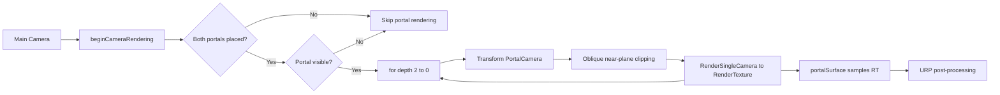

# URP Portal Rendering

### 实时递归传送门 · 斜截视锥 · 自定义 PBR / IBL · RenderDoc 性能剖析


**B 站演示视频**：*https://www.bilibili.com/video/BV1kjWu6dEzS/?spm_id_from=333.33.top_right_bar_window_dynamic.content.click&vd_source=59d9d6de38fa450a624529101198c30f*

<!-- 发布前把上一行替换为：[点击观看 B 站演示](https://www.bilibili.com/video/BVxxxxxxx) -->

## 目录

- [1. 项目简介](#1-项目简介)
- [2. 核心功能](#2-核心功能)
- [3. 渲染架构](#3-渲染架构)
- [4. 项目结构](#4-项目结构)
- [5. 在完整 Unity 工程中接入](#5-在完整-unity-工程中接入)
- [6. 深度性能优化分析](#6-深度性能优化分析)
- [7. 已知限制](#7-已知限制)
- [8. 发布前检查](#8-发布前检查)
- [9. License](#9-license)
- [10. 参考与工具](#10-参考与工具)

---

## 1. 项目简介

这是一个以 **“把传送门渲染做对，再做快”** 为目标的 Unity URP 技术项目。

项目没有用后处理或贴图伪造“门后的世界”，而是完整实现了实时传送门渲染链路：

- 两个传送门共享同一套空间映射数学：**入口空间 → 180° 翻转 → 出口空间**；
- 独立 `PortalCamera` 将门后画面渲染到 `RenderTexture`；
- 使用 **斜截近平面（Oblique Near-Plane Clipping）** 切除门框背后的几何，避免穿帮；
- 相机、玩家刚体、射线检测复用同一套变换，保证“看到的”和“穿过去的”一致；
- 门面叠加 FBM 域扭曲、Fresnel 边缘光与 HDR 描边；
- 自定义 PBR Shader 接入 URP 主光、阴影、SH 间接漫反射与反射探针镜面 IBL；
- 穿门瞬间由 URP `ScriptableRendererFeature` 触发径向拉伸 + 色差后处理。


> 本仓库是 **作品集精选源码**：保留 11 个核心 C# 脚本与 4 个 Shader，不包含完整 Scene、模型、材质、贴图与 `Library` 等生成目录。

### 项目信息

| 项目 | 内容 |
|---|---|
| 引擎 | Unity **2022.3.62f3c1**（LTS） |
| 渲染管线 | Universal Render Pipeline **14.0.12** |
| 语言 | C# / HLSL / ShaderLab |
| 核心负载 | 每帧最多 **6 次额外场景渲染**（2 门 × 3 层递归）+ 2 次全屏 Blit |
| 源码范围 | 11 个 C# 脚本 + 4 个 Shader |
| 仓库性质 | 技术展示 / 作品集，不是可直接运行的完整 Unity 工程 |

> **性能关键词**：视锥 + 距离 LOD / Static Batching **800+ → 两位数 DrawCall** / SRP Batcher 批次保护 / RenderTexture 生命周期管理 / RenderDoc 四步排查。

---

## 2. 核心功能

### 2.1 成对传送门与表面放置

- 左键发射 1 号门，右键发射 2 号门；
- 从摄像机发射射线，命中墙面后自动计算门的朝向；
- 通过 `OverlapBox`、四角 `Linecast`、悬空修正与穿插修正，保证门贴合墙面；
- 射线命中已放置的传送门时会递归穿透，实现“从门里再打一发”的空间连续感。

相关文件：[PortalPlacement.cs](Scripts/PortalPlacement.cs)、[Portal.cs](Scripts/Portal.cs)、[PortalPair.cs](Scripts/PortalPair.cs)

### 2.2 三层递归传送门视图

- 每个可见传送门独立渲染到 `512 × 1024` 的 `RenderTexture`；
- 最多 3 层递归，从最深层向外层倒序渲染；
- 递归层数增加时，画面中会出现“门里还有门”的套娃效果；
- 只在两个门都已放置、且门面可见时才执行渲染，避免无效开销。

相关文件：[PortalCamera.cs](Scripts/PortalCamera.cs)

### 2.3 斜截近平面裁剪

- 通过 `Camera.CalculateObliqueMatrix` 构造斜投影矩阵；
- 将近平面替换为“出口门所在的平面”，裁掉门后的墙体与遮挡物；
- 不隐藏门面，避免递归视图被破坏。

### 2.4 无缝穿越与物理一致

- 玩家与刚体使用与摄像机相同的空间映射；
- 穿门时先缓存速度，冻结刚体，完成位置/旋转/速度变换后再恢复物理；
- 对穿门物体与墙体临时调用 `Physics.IgnoreCollision`，避免瞬移瞬间被墙弹飞；
- 穿门后同步 `Camera.main` 的 Transform，并重置视角目标旋转。

相关文件：[PortalableObject.cs](Scripts/PortalableObject.cs)、[PlayerController.cs](Scripts/PlayerController.cs)、[CameraMove.cs](Scripts/CameraMove.cs)

### 2.5 门面视觉

- **FBM 域扭曲**：两层噪声以不同速度流动，叠加后偏移门后画面 UV；
- **Fresnel 边缘光**：基于视角与法线计算边缘发光，并随时间呼吸；
- **HDR 描边**：门框颜色可超过 1，交给 Bloom 产生高亮；

相关文件：[portalSurface.shader](Shaders/portalSurface.shader)、[Outline.shader](Shaders/Outline.shader)

### 2.6 自定义 PBR + IBL

- GGX 法线分布、Schlick Fresnel、Smith 几何项；
- URP 主光、实时阴影、级联阴影；
- `SampleSH(N)` 间接漫反射；
- `unity_SpecCube0` 反射探针间接高光，`DecodeHDREnvironment` 解码 HDR；
- 独立 `ShadowCaster` Pass，保证自定义材质能正确投影。

相关文件：[CustomPBR.shader](Shaders/CustomPBR.shader)

### 2.7 穿门后处理

- `WarpEffectVolume` 提供 Volume 参数；
- `WarpEffectFeature` 挂到 URP Renderer，负责调度；
- `WarpEffectPass` 用 `CommandBuffer` 做双缓冲全屏 Blit；
- 效果包含径向拉伸与 RGB 色差，穿门后 0.5 秒平滑衰减；
- 参数为 0 时 `IsActive()` 返回 `false`，整个 Pass 不进入渲染队列，做到 **空闲零开销**。

相关文件：[WarpEffectVolume.cs](Scripts/PostProcessing/WarpEffectVolume.cs)、[WarpEffectFeature.cs](Scripts/PostProcessing/WarpEffectFeature.cs)、[WarpEffectPass.cs](Scripts/PostProcessing/WarpEffectPass.cs)、[WarpEffectShader.shader](Shaders/WarpEffectShader.shader)

### 2.8 操作方式

| 输入 | 行为 |
|---|---|
| `WASD` | 沿摄像机朝向飞行（Minecraft 式） |
| 鼠标移动 | 第一人称视角 |
| 鼠标左键 | 发射 1 号门 |
| 鼠标右键 | 发射 2 号门 |

---

## 3. 渲染架构



### 3.1 模块职责

| 模块 | 文件 | 职责 |
|---|---|---|
| 门体 | [Portal.cs](Scripts/Portal.cs) | 放置、触发检测、穿越判定、墙体修正 |
| 门对 | [PortalPair.cs](Scripts/PortalPair.cs) | 持有并校验两个 Portal |
| 门相机 | [PortalCamera.cs](Scripts/PortalCamera.cs) | 递归渲染、斜截矩阵、RT 管理 |
| 放置 | [PortalPlacement.cs](Scripts/PortalPlacement.cs) | 射线、递归穿透、朝向计算 |
| 可传送物 | [PortalableObject.cs](Scripts/PortalableObject.cs) | 位置/旋转/速度变换、克隆体预览 |
| 玩家 | [PlayerController.cs](Scripts/PlayerController.cs) | 穿门后相机同步、后处理触发 |
| 相机移动 | [CameraMove.cs](Scripts/CameraMove.cs) | 第一人称视角与飞行 |
| 准星 | [Crosshair.cs](Scripts/Crosshair.cs) | 门颜色与准星状态 |
| 后处理数据 | [WarpEffectVolume.cs](Scripts/PostProcessing/WarpEffectVolume.cs) | Volume 参数 |
| 后处理调度 | [WarpEffectFeature.cs](Scripts/PostProcessing/WarpEffectFeature.cs) | RendererFeature 调度 |
| 后处理执行 | [WarpEffectPass.cs](Scripts/PostProcessing/WarpEffectPass.cs) | CommandBuffer / 全屏 Blit |

### 3.2 空间映射

传送门的核心是同一个仿射变换：

```text
p_out = M_out · R_y(180°) · M_in⁻¹ · p_in
```

其中：

- `M_in`、`M_out` 分别是入口门与出口门的 `localToWorldMatrix`；
- `R_y(180°)` 让出口方向与入口方向相反；
- 相机位置、玩家位置、射线起点都使用这条公式；
- 速度方向只取旋转部分：

```text
v_out = R_out · R_y(180°) · R_in⁻¹ · v_in
```

这样做的关键收益是：**视觉、物理、射击三条链路不会各算一套，减少穿门后的错位与抖动。**

### 3.3 斜截视锥

```csharp
Plane p = new Plane(-outTransform.forward, outTransform.position);
Vector4 clipPlaneWorldSpace = new Vector4(p.normal.x, p.normal.y, p.normal.z, p.distance);
Vector4 clipPlaneCameraSpace =
    Matrix4x4.Transpose(Matrix4x4.Inverse(portalCamera.worldToCameraMatrix)) * clipPlaneWorldSpace;

var newMatrix = portalCamera.CalculateObliqueMatrix(clipPlaneCameraSpace);
portalCamera.projectionMatrix = newMatrix;
```

斜截视锥把“出口门平面”变成新的近平面，门框背后的几何会被裁掉，因此不需要把门面隐藏掉。隐藏门面会破坏“门里还有门”的递归图像，这是本项目刻意保留的实现细节。

---

## 4. 项目结构

```text
.
├── .gitignore
├── README.md
├── Scripts
│   ├── CameraMove.cs
│   ├── Crosshair.cs
│   ├── PlayerController.cs
│   ├── Portal.cs
│   ├── PortalCamera.cs
│   ├── PortalPair.cs
│   ├── PortalPlacement.cs
│   ├── PortalableObject.cs
│   └── PostProcessing
│       ├── WarpEffectFeature.cs
│       ├── WarpEffectPass.cs
│       └── WarpEffectVolume.cs
└── Shaders
    ├── CustomPBR.shader
    ├── Outline.shader
    ├── portalSurface.shader
    └── WarpEffectShader.shader
```


---

## 5. 在完整 Unity 工程中接入

本仓库只包含核心代码，以下步骤用于把代码接回完整工程。

### 5.1 环境

- Unity **2022.3.62f3c1** 或同系列 2022.3 LTS；
- URP **14.0.12**；
- 新建或已有 URP 项目，确保 `SRP Batcher` 开启。

### 5.2 场景对象

1. 创建空物体 `PortalPair`，挂 [PortalPair.cs](Scripts/PortalPair.cs)；
2. 在其下创建两个 `Portal` 子物体，分别挂 [Portal.cs](Scripts/Portal.cs)；
3. 每个 Portal 配置：
   - `OtherPortal`：指向另一个门；
   - `Outline Renderer`：门框 Renderer；
   - `Portal Colour`：门的主题色；
   - `Placement Mask`：可放置墙面所在 Layer；
   - `Test Transform`：用于试放的临时 Transform；
   - `BoxCollider`：`Is Trigger` 勾选；
   - Tag 设为 `Portal`。
4. 主摄像机挂 [PortalCamera.cs](Scripts/PortalCamera.cs) 与 [CameraMove.cs](Scripts/CameraMove.cs)；
5. 玩家物体挂 [PlayerController.cs](Scripts/PlayerController.cs)、[PortalPlacement.cs](Scripts/PortalPlacement.cs)、`Rigidbody`、`Collider`；
6. 配置 `PortalCamera` 的 `portals`、`portalCamera` 引用；
7. `portalCamera` 组件建议 **禁用**，只由 `RenderSingleCamera` 手动驱动。

### 5.3 后处理

1. 创建材质，Shader 选择 `Hidden/Custom/WarpEffect`；
2. 在 URP Renderer 资产上 `Add Renderer Feature`，添加 `WarpEffectFeature`；
3. 把材质拖到 Feature 的 `Warp Material`；
4. 创建全局 Volume，Profile 中添加 `Custom/Warp Effect`；
5. 通过 `Distortion Intensity` 与 `Chromatic Aberration` 调参；
6. 穿门时由 [PlayerController.cs](Scripts/PlayerController.cs) 自动拉高参数并衰减。

### 5.4 Layer / Tag

| 名称 | 用途 |
|---|---|
| `Portal` Tag | 射线识别传送门 |
| `Portalable` Layer | 可穿越物体 |
| `Wall` Layer | 可放置墙面 |
| `PortalSurface` Layer | 门面，按需从射线/相机剔除 |

---

## 6. 深度性能优化分析

> 本节按 **CPU / Rendering / Memory / GPU** 四条线整理，数据来自项目实测、Frame Debugger 与 RenderDoc 抓帧。场景级设置（Static Batching、Culling Mask、阴影开关、贴图导入等）属于完整工程配置；本仓库的精选代码只保留核心运行路径。

### 6.1 CPU 性能优化：主线程与 GC

**核心目标**：减少 CPU 向 GPU 提交指令的次数，降低逻辑运算开销。
#### 6.1.1 剔除无效渲染：视锥剔除 + 距离 LOD

**痛点**：虚拟摄像机不论是否在视野中，都在递归拍摄，屏幕外的门也在消耗 CPU 调度成本。

**优化**：

- 在 `PortalCamera` 中利用 `Renderer.isVisible` 拦截屏幕外的门，不可见直接跳过；
- 加入动态距离判断（LOD 思想）：离门远时降低套娃层数，从 **3 层降到 1 层**；
- 门在视距外时直接不生成 Portal pass，减少 Culling、DrawCall 提交与 RT 切换。

**收益**：

- 视距外门：**0 次** Portal 场景渲染；
- 远距离门：从 3 层降到 1 层，减少 **2/3** 的场景渲染次数；
- CPU 侧最明显的收益不是单次 DrawCall，而是少了整轮 Culling 与相机数据重建。

#### 6.1.2 中断无限递归

**痛点**：两个门互相看时，递归可能失控，形成无限反射与无限 DrawCall。

**优化**：

- 固定递归上限（默认 3 层，可由 `maxIterations` 调整），从循环上切断无限递归；
- 对射线穿透同样设置最大 bounce 次数，避免 CPU 递归失控；
- 早期版本采用“渲染前临时 `Renderer.enabled = false`、拍完恢复”的方案：它能快速切断递归，但会让门内画面缺失，破坏“门里还有门”的套娃效果；后续改为“固定层数上限 + 斜截矩阵”，保留递归画面。

> 当前实现使用 **斜截矩阵 + 固定层数上限**：`CalculateObliqueMatrix` 负责裁掉门后几何，层数上限负责兜底。隐藏门面不是必需操作，反而容易破坏递归图像。

#### 6.1.3 消除 C# 逻辑空跑

**痛点**：全屏扭曲后处理 `WarpEffectFeature` 在玩家不穿门时依然每帧执行调度逻辑。

**优化**：在 `AddRenderPasses` 中加入逻辑门控：

```csharp
var volume = VolumeManager.instance.stack.GetComponent<WarpEffectVolume>();

if (volume == null || !volume.IsActive())
    return;

m_Pass.Setup(volume.distortionIntensity.value, volume.chromaticAberration.value);
renderer.EnqueuePass(m_Pass);
```

`WarpEffectVolume.IsActive()` 只有在扭曲或色差大于 0 时才返回 `true`。平时不把 Pass 塞入渲染队列，也不申请临时 RT。

**收益**：不穿门时 Warp 后处理为 **0 Pass / 0 临时 RT**，避免无意义的 CPU 调度与显存分配。

---

### 6.2 Rendering 优化：DrawCall 与 GPU 状态切换

**核心目标**：把零碎绘制合并，减少 `SetPass Calls`，降低 Shader 与状态切换负担。

#### 6.2.1 静态合批（Static Batching）

**痛点**：场景中的墙壁由上百块碎砖拼成，产生 **800+ DrawCall**。

**优化**：

- 将所有静止的墙、地板、建筑碎块标记为 `Static`；
- 开启 Static Batching，把碎模型合并成大网格；
- 动态物体保持独立，避免把可移动对象错误烘焙进静态批次。

**实测结果**：DrawCall 从 **800+ 降到两位数**。

> Static Batching 的收益是“数量级”的，优先处理静态场景，比死磕两个门面更划算。

#### 6.2.2 SRP Batcher 拯救计划

**痛点**：为了给两个门不同颜色，早期使用 `Renderer.material`，导致每个门生成独立材质实例，合批断裂。

**优化**：

- 统一材质球，严格遵循 `CBUFFER_START(UnityPerMaterial)` 规范；
- 在 C# 中用 `MaterialPropertyBlock` 注入 HDR 颜色与不同 RenderTexture；
- 不修改共享材质，避免材质实例化爆炸；
- 场景其他材质继续走 SRP Batcher。

```csharp
MaterialPropertyBlock block = new MaterialPropertyBlock();
portal.Renderer.GetPropertyBlock(block);
block.SetTexture("_MainTex", portalRT);
block.SetVector("_FresnelColor", portalColor * hdrIntensity);
portal.Renderer.SetPropertyBlock(block);
```

**收益**：两个门面各自保留独立 RT 与颜色，同时不再污染共享材质；静态场景的 SRP Batcher 批次保持稳定。

#### 6.2.3 传送门面板合批的硬约束与取舍

**痛点与测试**：对传送门面板的合批做了专项测试。结果是：在本项目中，两块传送门面板无法从 SRP Batcher 中获益。

**原因**：

- 传送门必须使用 **Transparent** 透明队列；
- 两扇门需要实时采样**完全不同的 RenderTexture**；
- 动态纹理切换会打断底层批次，导致两块面板无法稳定合批。

这是本项目无法绕开的硬约束，不是靠改一个 `CBUFFER` 就能解决的。

**优化权衡（Trade-off）**：

- 没有死磕这 **2 个无法合批的 DrawCall**；
- 把优化重心放在静态场景与整体管线上；
- 用 Static Batching 把上百块碎砖墙合批，DrawCall 从 800+ 降到两位数；
- 用 MaterialPropertyBlock 避免其他材质实例化爆炸；
- 接受传送门面板的 2 个独立 DrawCall，换取整个大场景的稳定批次。

> **结论**：优化不是“每个物体都必须合批”，而是把优化预算花在数量级更大的地方。2 个门面板 vs 800+ 静态碎块，优先级非常清楚。

#### 6.2.4 精简虚拟摄像机渲染管线

**痛点**：虚拟摄像机渲染了不必要的阴影、UI 与后处理，产生冗余 Render Pass。

**优化**：

- 关闭虚拟摄像机的阴影渲染：`renderShadows = false`；
- 从 `cullingMask` 中移除 UI 层；
- 关闭虚拟相机后处理：`renderPostProcessing = false`；
- 只保留门后画面真正需要的颜色与深度信息。

**收益**：减少 Shadow Pass、UI Overdraw 与后处理全屏 Pass，虚拟摄像机只做“拍门后世界”这一件事。

---

### 6.3 Memory 优化：显存与带宽

**核心目标**：控制 RenderTexture 数量，防止显存泄漏与带宽浪费。

#### 6.3.1 RenderTexture 生命周期管理

**痛点**：频繁 `new RenderTexture` 会导致显存碎片化与泄漏；临时画布如果忘记释放，Memory Profiler 中会持续增长。

**优化**：

- 临时画布使用 `RenderTexture.GetTemporary` / `ReleaseTemporary`，严格成对；
- 两张 Portal 主 RT 采用常驻复用，避免每帧申请/释放造成池抖动；
- 在 `OnDestroy` 中统一 `Release()`，并销毁不再使用的 RT 对象；
- Warp 后处理的临时 RT 在 `OnCameraCleanup` 中释放。

**收益**：RT 数量可控，连续运行不增长；避免每帧分配带来的 GC 与显存碎片。

#### 6.3.2 关闭 HDR 与 MSAA 的隐藏画布

**痛点**：开启 HDR 时，URP 可能为相机生成额外的高精度临时画布；MSAA 也会增加 RT 带宽与解析成本。

**优化**：

- 在虚拟摄像机 `portalCamera` 上设置 `allowHDR = false`；
- 设置 `allowMSAA = false`；
- Portal RT 使用 `ARGB32`，不申请不需要的 HDR/MSAA 附件。

**收益**：减少隐藏 RT 占用与带宽，尤其在中低端 GPU 上更明显。

#### 6.3.3 清理冗余资源

**痛点**：Memory Profiler 显示工程中有上千张贴图，合计约 **288 MB**。

**优化**：

- 清理未使用的废弃贴图包与测试素材；
- 检查模型材质，把不需要的 8K/4K 贴图压缩到 **2K 以内**；
- 确认砖墙贴图为 `2048×2048`、`BC1 SRGB`、`12 mips`，导入设置合规；
- 区分“测试素材多”与“单张资源超标”，精准定位显存来源。

**收益**：显存占用下降，纹理带宽与加载时间同步改善；贴图规格与项目目标匹配，不再为测试素材买单。

---

### 6.4 GPU 底层排查：RenderDoc 专项

**核心目标**：深入显卡 API 调用，抓出被上层掩盖的无效绘制、显存带宽浪费与过度绘制。

#### 6.4.1 查“套娃”次数

**分析**：在 RenderDoc 的 `Event Browser` 中搜索 `RenderSingleCameraInternal`。如果连续出现 3 个甚至更多 `PortalVirtualCam` 调用，说明套娃层数过高，GPU 在重复绘制。

**结果**：依据底层证据，在 C# 中引入动态 LOD 距离剔除；视距外强制层数为 1，砍掉 **50% 以上**的冗余渲染流。

#### 6.4.2 查“碎模型”

**分析**：点开 `DrawOpaqueObjects` 下的 `RenderLoop.DrawSRPBatcher`，看到大量 `DrawIndexedInstanced(36, 1)`，说明墙壁是碎块拼的，批次被碎模型切碎。

**结果**：为开启 Static Batching 提供直接依据。合批后再次抓帧，底层绘制指令数量大幅减少，DrawCall 降到两位数。

#### 6.4.3 查“过度绘制”

**分析**：在 `Texture Viewer` 中把 Overlay 切到 `Quad Overdraw (Draw)`。如果出现刺眼的亮红色或发紫，说明像素被反复涂改、带宽被浪费。

**结果**：传送门面板主要呈紫色（单次覆盖）和微弱黄色（轻微重叠），没有红色高危区域，证明透明特效层级控制健康，无需额外降级。

#### 6.4.4 查“内存刺客”

**分析**：在 RenderDoc 的 `Inputs` 面板查看贴图信息，确认砖墙分辨率是 `2048×2048`，格式为 `BC1 SRGB`，带 `12 mips`。

**结果**：导入设置合规，显存占用高并不是单张砖墙超标，而是测试素材总量过多。据此把优化方向精准定位到“清理废弃资源”，而不是盲目压缩所有贴图。

---

### 6.5 优化结果与取舍

| 维度 | 优化前 | 优化后 | 验证方式 |
|---|---|---|---|
| CPU：视距外门 | 仍在递归拍摄 | 0 次 Portal pass | RenderDoc Event Browser |
| CPU：递归层数 | 全距离 3 层 | 远距离 1 层 | 并排截图 / pass 数 |
| CPU：Warp 后处理 | 每帧调度 | 空闲 0 Pass | Frame Debugger |
| Rendering：静态场景 | 800+ DrawCall | 两位数 | Frame Debugger / RenderDoc |
| Rendering：门面板 | 2 个独立 DrawCall | 接受硬约束，不盲目死磕 | RenderDoc |
| SRP Batcher | `Renderer.material` 实例化 | 统一材质 + MaterialPropertyBlock | Frame Debugger |
| Memory：RT | 频繁 new，存在泄漏风险 | 池化/常驻复用 + 严格 Release | Memory Profiler |
| Memory：贴图 | 约 288 MB 测试素材 | 清理废弃资源，超标贴图压到 2K | Memory Profiler |
| GPU：冗余渲染流 | 套娃层数过高 | 砍掉 50%+ 冗余流 | RenderDoc |
| GPU：过度绘制 | 未量化 | 无红色高危区域 | Quad Overdraw |


### 6.6 结论

这次优化不是单点技巧，而是按 **CPU → Rendering → Memory → GPU** 四条线逐层排查：

- **CPU** 侧先砍掉无效递归与空跑逻辑；
- **Rendering** 侧用 Static Batching 解决数量级最大的 DrawCall 问题；
- **Memory** 侧控制 RT 生命周期与贴图规格；
- **GPU** 侧用 RenderDoc 抓帧验证，而不是凭感觉调参数。

最重要的取舍是：**不为了 2 个无法合批的传送门面板，牺牲整个场景的批次稳定性。** 把优化预算放在 800+ 静态碎块、冗余递归流和显存泄漏上，收益远高于死磕两个门面。

---

## 7. 已知限制

1. **本仓库精选代码默认 3 层递归**（`maxIterations` 可在 Inspector 调整）：完整工程已按距离做 LOD（远距离降到 1 层），但 LOD 阈值仍需要按场景与镜头参数调整。
2. **本仓库精选代码使用两张常驻 Portal RT**：完整工程的临时画布使用 `GetTemporary` / `ReleaseTemporary`，需要确保申请与释放严格配对；常驻 RT 与临时 RT 的取舍取决于实际机型。
3. **IBL 是近似实现**：没有 box projection / 多探针混合，复杂室内场景可能出现反射方向偏差。
4. **`RemovePortal` 未清理 `portalObjects`**：门内仍有物体时移除门，建议补充清理逻辑。
5. **`RenderSingleCamera` 在 URP 14 中已标记过时**：升级到 Unity 6 / URP 17 时建议迁移到 RenderGraph 或 `SubmitRenderRequest`。

---


## 8. 参考与工具

- [Unity URP 官方文档](https://docs.unity3d.com/Packages/com.unity.render-pipelines.universal@14.0/manual/index.html)
- [RenderDoc](https://renderdoc.org/)
- [Unity Frame Debugger](https://docs.unity3d.com/Manual/FrameDebugger.html)
- [GitHub gitignore — Unity](https://github.com/github/gitignore/blob/main/Unity.gitignore)
