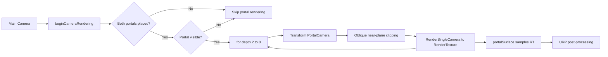

# URP Portal Rendering

### 实时递归传送门 · 斜截视锥 · 自定义 PBR / IBL · RenderDoc 性能剖析


**B 站演示视频**：*（链接待补充）*

<!-- 发布前把上一行替换为：[点击观看 B 站演示](https://www.bilibili.com/video/BVxxxxxxx) -->

## 目录

- [1. 项目简介](#1-项目简介)
- [2. 核心功能](#2-核心功能)
- [3. 渲染架构](#3-渲染架构)
- [4. 项目结构](#4-项目结构)
- [5. 在完整 Unity 工程中接入](#5-在完整-unity-工程中接入)
- [6. 深度性能优化分析](#6-深度性能优化分析)
- [7. 已知限制](#7-已知限制)
- [8. 发布前检查](#8-发布前检查)
- [9. License](#9-license)
- [10. 参考与工具](#10-参考与工具)

---

## 1. 项目简介

这是一个以 **“把传送门渲染做对，再做快”** 为目标的 Unity URP 技术项目。

项目没有用后处理或贴图伪造“门后的世界”，而是完整实现了实时传送门渲染链路：

- 两个传送门共享同一套空间映射数学：**入口空间 → 180° 翻转 → 出口空间**；
- 独立 `PortalCamera` 将门后画面渲染到 `RenderTexture`；
- 使用 **斜截近平面（Oblique Near-Plane Clipping）** 切除门框背后的几何，避免穿帮；
- 相机、玩家刚体、射线检测复用同一套变换，保证“看到的”和“穿过去的”一致；
- 门面叠加 FBM 域扭曲、Fresnel 边缘光、HDR 描边与 Stencil 遮罩；
- 自定义 PBR Shader 接入 URP 主光、阴影、SH 间接漫反射与反射探针镜面 IBL；
- 穿门瞬间由 URP `ScriptableRendererFeature` 触发径向拉伸 + 色差后处理。

> 本仓库是 **作品集精选源码**：保留 11 个核心 C# 脚本与 5 个 Shader，不包含完整 Scene、模型、材质、贴图与 `Library` 等生成目录。

### 项目信息

| 项目 | 内容 |
|---|---|
| 引擎 | Unity **2022.3.62f3c1**（LTS） |
| 渲染管线 | Universal Render Pipeline **14.0.12** |
| 语言 | C# / HLSL / ShaderLab |
| 核心负载 | 每帧最多 **6 次额外场景渲染**（2 门 × 3 层递归）+ 2 次全屏 Blit |
| 源码范围 | 11 个 C# 脚本 + 5 个 Shader |
| 仓库性质 | 技术展示 / 作品集，不是可直接运行的完整 Unity 工程 |

> **性能关键词**：最坏 **6 次额外场景渲染** / **3.15 MP** Portal 像素 / **7–8 MB** RT 显存 / Warp 空闲时 **0 Pass**。

---

## 2. 核心功能

### 2.1 成对传送门与表面放置

- 左键发射 1 号门，右键发射 2 号门；
- 从摄像机发射射线，命中墙面后自动计算门的朝向；
- 通过 `OverlapBox`、四角 `Linecast`、悬空修正与穿插修正，保证门贴合墙面；
- 射线命中已放置的传送门时会递归穿透，实现“从门里再打一发”的空间连续感。

相关文件：[PortalPlacement.cs](Scripts/PortalPlacement.cs)、[Portal.cs](Scripts/Portal.cs)、[PortalPair.cs](Scripts/PortalPair.cs)

### 2.2 三层递归传送门视图

- 每个可见传送门独立渲染到 `512 × 1024` 的 `RenderTexture`；
- 最多 3 层递归，从最深层向外层倒序渲染；
- 递归层数增加时，画面中会出现“门里还有门”的套娃效果；
- 只在两个门都已放置、且门面可见时才执行渲染，避免无效开销。

相关文件：[PortalCamera.cs](Scripts/PortalCamera.cs)

### 2.3 斜截近平面裁剪

- 通过 `Camera.CalculateObliqueMatrix` 构造斜投影矩阵；
- 将近平面替换为“出口门所在的平面”，裁掉门后的墙体与遮挡物；
- 不隐藏门面，避免递归视图被破坏。

### 2.4 无缝穿越与物理一致

- 玩家与刚体使用与摄像机相同的空间映射；
- 穿门时先缓存速度，冻结刚体，完成位置/旋转/速度变换后再恢复物理；
- 对穿门物体与墙体临时调用 `Physics.IgnoreCollision`，避免瞬移瞬间被墙弹飞；
- 穿门后同步 `Camera.main` 的 Transform，并重置视角目标旋转。

相关文件：[PortalableObject.cs](Scripts/PortalableObject.cs)、[PlayerController.cs](Scripts/PlayerController.cs)、[CameraMove.cs](Scripts/CameraMove.cs)

### 2.5 门面视觉

- **FBM 域扭曲**：两层噪声以不同速度流动，叠加后偏移门后画面 UV；
- **Fresnel 边缘光**：基于视角与法线计算边缘发光，并随时间呼吸；
- **HDR 描边**：门框颜色可超过 1，交给 Bloom 产生高亮；
- **Stencil 遮罩**：`PortalMask` 写入 Stencil，`Outline` 只在非门面区域绘制。

相关文件：[portalSurface.shader](Shaders/portalSurface.shader)、[Outline.shader](Shaders/Outline.shader)、[PortalMask.shader](Shaders/PortalMask.shader)

### 2.6 自定义 PBR + IBL

- GGX 法线分布、Schlick Fresnel、Smith 几何项；
- URP 主光、实时阴影、级联阴影；
- `SampleSH(N)` 间接漫反射；
- `unity_SpecCube0` 反射探针间接高光，`DecodeHDREnvironment` 解码 HDR；
- 独立 `ShadowCaster` Pass，保证自定义材质能正确投影。

相关文件：[CustomPBR.shader](Shaders/CustomPBR.shader)

### 2.7 穿门后处理

- `WarpEffectVolume` 提供 Volume 参数；
- `WarpEffectFeature` 挂到 URP Renderer，负责调度；
- `WarpEffectPass` 用 `CommandBuffer` 做双缓冲全屏 Blit；
- 效果包含径向拉伸与 RGB 色差，穿门后 0.5 秒平滑衰减；
- 参数为 0 时 `IsActive()` 返回 `false`，整个 Pass 不进入渲染队列，做到 **空闲零开销**。

相关文件：[WarpEffectVolume.cs](Scripts/PostProcessing/WarpEffectVolume.cs)、[WarpEffectFeature.cs](Scripts/PostProcessing/WarpEffectFeature.cs)、[WarpEffectPass.cs](Scripts/PostProcessing/WarpEffectPass.cs)、[WarpEffectShader.shader](Shaders/WarpEffectShader.shader)

### 2.8 操作方式

| 输入 | 行为 |
|---|---|
| `WASD` | 沿摄像机朝向飞行（Minecraft 式） |
| 鼠标移动 | 第一人称视角 |
| 鼠标左键 | 发射 1 号门 |
| 鼠标右键 | 发射 2 号门 |

---

## 3. 渲染架构



### 3.1 模块职责

| 模块 | 文件 | 职责 |
|---|---|---|
| 门体 | [Portal.cs](Scripts/Portal.cs) | 放置、触发检测、穿越判定、墙体修正 |
| 门对 | [PortalPair.cs](Scripts/PortalPair.cs) | 持有并校验两个 Portal |
| 门相机 | [PortalCamera.cs](Scripts/PortalCamera.cs) | 递归渲染、斜截矩阵、RT 管理 |
| 放置 | [PortalPlacement.cs](Scripts/PortalPlacement.cs) | 射线、递归穿透、朝向计算 |
| 可传送物 | [PortalableObject.cs](Scripts/PortalableObject.cs) | 位置/旋转/速度变换、克隆体预览 |
| 玩家 | [PlayerController.cs](Scripts/PlayerController.cs) | 穿门后相机同步、后处理触发 |
| 相机移动 | [CameraMove.cs](Scripts/CameraMove.cs) | 第一人称视角与飞行 |
| 准星 | [Crosshair.cs](Scripts/Crosshair.cs) | 门颜色与准星状态 |
| 后处理数据 | [WarpEffectVolume.cs](Scripts/PostProcessing/WarpEffectVolume.cs) | Volume 参数 |
| 后处理调度 | [WarpEffectFeature.cs](Scripts/PostProcessing/WarpEffectFeature.cs) | RendererFeature 调度 |
| 后处理执行 | [WarpEffectPass.cs](Scripts/PostProcessing/WarpEffectPass.cs) | CommandBuffer / 全屏 Blit |

### 3.2 空间映射

传送门的核心是同一个仿射变换：

```text
p_out = M_out · R_y(180°) · M_in⁻¹ · p_in
```

其中：

- `M_in`、`M_out` 分别是入口门与出口门的 `localToWorldMatrix`；
- `R_y(180°)` 让出口方向与入口方向相反；
- 相机位置、玩家位置、射线起点都使用这条公式；
- 速度方向只取旋转部分：

```text
v_out = R_out · R_y(180°) · R_in⁻¹ · v_in
```

这样做的关键收益是：**视觉、物理、射击三条链路不会各算一套，减少穿门后的错位与抖动。**

### 3.3 斜截视锥

```csharp
Plane p = new Plane(-outTransform.forward, outTransform.position);
Vector4 clipPlaneWorldSpace = new Vector4(p.normal.x, p.normal.y, p.normal.z, p.distance);
Vector4 clipPlaneCameraSpace =
    Matrix4x4.Transpose(Matrix4x4.Inverse(portalCamera.worldToCameraMatrix)) * clipPlaneWorldSpace;

var newMatrix = mainCamera.CalculateObliqueMatrix(clipPlaneCameraSpace);
portalCamera.projectionMatrix = newMatrix;
```

斜截视锥把“出口门平面”变成新的近平面，门框背后的几何会被裁掉，因此不需要把门面隐藏掉。隐藏门面会破坏“门里还有门”的递归图像，这是本项目刻意保留的实现细节。

---

## 4. 项目结构

```text
.
├── .gitignore
├── README.md
├── Scripts
│   ├── CameraMove.cs
│   ├── Crosshair.cs
│   ├── PlayerController.cs
│   ├── Portal.cs
│   ├── PortalCamera.cs
│   ├── PortalPair.cs
│   ├── PortalPlacement.cs
│   ├── PortalableObject.cs
│   └── PostProcessing
│       ├── WarpEffectFeature.cs
│       ├── WarpEffectPass.cs
│       └── WarpEffectVolume.cs
└── Shaders
    ├── CustomPBR.shader
    ├── Outline.shader
    ├── PortalMask.shader
    ├── portalSurface.shader
    └── WarpEffectShader.shader
```

> `.meta` 文件未复制：本仓库是源码展示，不是可直接导入的 Unity 工程。若要把这些脚本/Shader 放回完整工程，请以原工程的 `.meta` 为准，避免 GUID 冲突。

---

## 5. 在完整 Unity 工程中接入

本仓库只包含核心代码，以下步骤用于把代码接回完整工程。

### 5.1 环境

- Unity **2022.3.62f3c1** 或同系列 2022.3 LTS；
- URP **14.0.12**；
- 新建或已有 URP 项目，确保 `SRP Batcher` 开启。

### 5.2 场景对象

1. 创建空物体 `PortalPair`，挂 [PortalPair.cs](Scripts/PortalPair.cs)；
2. 在其下创建两个 `Portal` 子物体，分别挂 [Portal.cs](Scripts/Portal.cs)；
3. 每个 Portal 配置：
   - `OtherPortal`：指向另一个门；
   - `Outline Renderer`：门框 Renderer；
   - `Portal Colour`：门的主题色；
   - `Placement Mask`：可放置墙面所在 Layer；
   - `Test Transform`：用于试放的临时 Transform；
   - `BoxCollider`：`Is Trigger` 勾选；
   - Tag 设为 `Portal`。
4. 主摄像机挂 [PortalCamera.cs](Scripts/PortalCamera.cs) 与 [CameraMove.cs](Scripts/CameraMove.cs)；
5. 玩家物体挂 [PlayerController.cs](Scripts/PlayerController.cs)、[PortalPlacement.cs](Scripts/PortalPlacement.cs)、`Rigidbody`、`Collider`；
6. 配置 `PortalCamera` 的 `portals`、`portalCamera` 引用；
7. `portalCamera` 组件建议 **禁用**，只由 `RenderSingleCamera` 手动驱动。

### 5.3 后处理

1. 创建材质，Shader 选择 `Hidden/Custom/WarpEffect`；
2. 在 URP Renderer 资产上 `Add Renderer Feature`，添加 `WarpEffectFeature`；
3. 把材质拖到 Feature 的 `Warp Material`；
4. 创建全局 Volume，Profile 中添加 `Custom/Warp Effect`；
5. 通过 `Distortion Intensity` 与 `Chromatic Aberration` 调参；
6. 穿门时由 [PlayerController.cs](Scripts/PlayerController.cs) 自动拉高参数并衰减。

### 5.4 Layer / Tag

| 名称 | 用途 |
|---|---|
| `Portal` Tag | 射线识别传送门 |
| `Portalable` Layer | 可穿越物体 |
| `Wall` Layer | 可放置墙面 |
| `PortalSurface` Layer | 门面，按需从射线/相机剔除 |

---

## 6. 深度性能优化分析

> 说明：下面把 **可由代码确定的结构成本** 与 **需要本地实测的毫秒数** 分开。不同场景、分辨率、CPU/GPU 的绝对帧时间差异很大，因此不把估算写成“实测 FPS”。所有优化项都给出验证方式，便于复现。

### 6.1 先看乘法：递归渲染的成本模型

传送门渲染不是“多一个 Pass”，而是“多 N 次场景渲染”。

```text
T_frame ≈ T_main + N_visible × L × (T_cull + T_submit + T_shadow + T_opaque + T_transparent) + T_warp
```

| 符号 | 含义 | 本项目取值 |
|---|---|---|
| `N_visible` | 同时可见的传送门数量 | 0 ~ 2 |
| `L` | 递归层数 | 3 |
| `T_warp` | 穿门后处理 | 仅特效激活时 2 次全屏 Blit |

因此最坏情况下：

- **6 次额外场景渲染**（2 门 × 3 层）；
- 每次都要重新 Culling、提交 DrawCall，并走一遍不透明/透明（以及可能的阴影）流程；
- 主视角仍然要渲染 1 次；
- 总计最多 **7 个场景视角** 在同一帧内完成。

这就是传送门项目最重要的性能事实：**分辨率可以降，但场景提交次数是乘出来的。**

### 6.2 结构成本基线

| 项目 | 数值 | 说明 |
|---|---|---|
| Portal RT 分辨率 | `512 × 1024` × 2 | 单张约 **0.524 MP** |
| Portal RT 显存 | 约 **7–8 MB** | ARGB32 颜色 + 24-bit 深度，取决于深度格式 |
| 额外场景渲染 | 最多 **6 次/帧** | 2 门 × 3 层 |
| Portal 像素上限 | **3.15 MP/帧** | 6 × 0.524 MP，不含主视角 |
| 全屏 Blit | **2 次/帧** | 仅 Warp 特效激活时 |
| 自定义 Shader | 5 个 | 3 个 SRP Batcher 兼容，1 个待补，1 个全屏 Pass |

把 3.15 MP 放进常见分辨率里看：

| 主视角分辨率 | 单帧像素 | Portal 像素占比（上限） |
|---|---:|---:|
| 1920 × 1080 | 2.07 MP | **约 152%** |
| 2560 × 1440 | 3.69 MP | **约 85%** |
| 3840 × 2160 | 8.29 MP | **约 38%** |

> 注意：这是“像素覆盖上限”，不是实际着色像素。斜截裁剪、视锥剔除和遮挡会减少实际值；但它足以说明：**单张 512×1024 很便宜，乘 6 之后就不再便宜。**

### 6.3 RenderDoc 抓帧：先确认“乘法”，再谈优化

建议用 **Development Build + RenderDoc** 抓一帧“两个门都可见、门内都有内容”的画面，按下面顺序看。

#### 抓帧步骤

1. Unity 打包 Development Build，勾选 `Autoconnect Profiler` 与 `Development Build`；
2. RenderDoc 启动游戏，按 `F12` 抓帧；
3. 在 `Event Browser` 搜索 `RenderSingleCamera`；
4. 在 `Pipeline State` 看 RenderTarget 尺寸、深度格式、混合状态；
5. 在 `Texture Viewer` 看 Portal RT、深度图与 `_TempWarpTexture`；
6. 在 `Mesh Viewer` 确认斜截后门框是否被裁掉。

> RenderDoc 的 Event 时间适合做相对比较；绝对 GPU 毫秒建议用 Unity Profiler 或平台 GPU 计时器交叉验证，避免把事件耗时直接当成 GPU 时间。

#### 抓帧时重点核对

| 视图 | 看什么 | 本项目关注点 |
|---|---|---|
| Event Browser | Pass 数量与顺序 | 是否出现 **6 个 PortalCamera 渲染组**；Warp 是否只在激活时出现 |
| Pipeline State | RT / 深度 / 混合 | `512×1024`、ARGB32、24-bit 深度、`ZWrite Off` |
| Texture Viewer | RT 内容 | Portal RT 是否正确、深度是否合理、临时 Blit 是否多余 |
| Mesh Viewer | 门面几何 | 斜截后是否仍能看到门后墙体 |
| API Calls | Draw / Dispatch 数 | 6 次场景渲染带来的提交放大 |

#### 一个典型帧的预期结构

```text
Main Camera
├─ Shadow / Depth / Opaque / Transparent
├─ PortalCamera pass #1  (depth 2)
├─ PortalCamera pass #2  (depth 1)
├─ PortalCamera pass #3  (depth 0)
├─ PortalCamera pass #4  (depth 2)
├─ PortalCamera pass #5  (depth 1)
├─ PortalCamera pass #6  (depth 0)
├─ portalSurface / Outline / PortalMask
└─ WarpEffectPass (only when active)
```

如果 Event Browser 中看到的 PortalCamera pass 数量明显多于 6，优先检查 [PortalCamera.cs](Scripts/PortalCamera.cs) 的相机回调是否被 Scene View、Overlay Camera 或预览相机重复触发。

#### 抓帧结论

- **GPU 像素成本**：单张 Portal RT 只有 0.524 MP，像素着色不是最主要的问题；
- **CPU 提交成本**：6 次 Culling + DrawCall 提交会被放大，场景越复杂越明显；
- **带宽成本**：Portal RT 的写入/采样、以及 Warp 的两次全屏 Blit 是主要带宽来源；
- **状态切换成本**：每次 `RenderSingleCamera` 都会切换 RT、重建相机数据，固定开销不可忽略。

### 6.4 SRP Batcher：它优化的是 SetPass，不是 DrawCall 数

先澄清一个常见误区：**SRP Batcher 不会减少 DrawCall 数量。**

它做的是：

- 把同一 Shader 变体的材质属性集中到持久 GPU 缓冲区；
- 减少 `SetPass` 与常量缓冲上传；
- 让 CPU 在 DrawCall 之间更快地切换材质；
- 但每个 Renderer 仍然是一次 DrawCall。

因此：

```text
DrawCall 数 ≈ 可见 Renderer 数（不含合批）
SRP Batcher 收益 ≈ 减少 SetPass / 常量上传，而不是减少 DrawCall
```

#### 兼容条件

一个 Shader 要被 SRP Batcher 接受，通常需要：

1. 所有材质属性放在 `CBUFFER_START(UnityPerMaterial)` / `CBUFFER_END` 中；
2. 使用相同的 Shader 变体；
3. 不使用会破坏批处理的 `MaterialPropertyBlock`；
4. 不依赖固定管线状态或每 Draw 的全局材质切换。

#### 本项目的 Shader 审计

| Shader | `UnityPerMaterial` | SRP Batcher | 备注 |
|---|---|---|---|
| [CustomPBR.shader](Shaders/CustomPBR.shader) | 完整 | ✅ | 主光/阴影/IBL 自定义 PBR |
| [portalSurface.shader](Shaders/portalSurface.shader) | 完整 | ✅ | 透明队列、`ZWrite Off` |
| [Outline.shader](Shaders/Outline.shader) | 完整 | ✅ | Stencil `equal 0` |
| [PortalMask.shader](Shaders/PortalMask.shader) | 缺失 | ❌ | `_MainTex` 未放入 CBUFFER |
| [WarpEffectShader.shader](Shaders/WarpEffectShader.shader) | 全局 uniform | N/A | 全屏 Pass，不走 SRP Batcher |

**结论：3/4 个场景 Shader 兼容 SRP Batcher。** `PortalMask` 只用于门面遮罩，单材质影响有限；如果后续要批量使用，补上：

```hlsl
CBUFFER_START(UnityPerMaterial)
    float4 _MainTex_ST;
CBUFFER_END
```

并把 `tex2D` 改成 URP 规范的：

```hlsl
TEXTURE2D(_MainTex);
SAMPLER(sampler_MainTex);
// ...
half4 col = SAMPLE_TEXTURE2D(_MainTex, sampler_MainTex, uv);
```

#### 变体数量

[CustomPBR.shader](Shaders/CustomPBR.shader) 使用了：

```hlsl
#pragma multi_compile _ _MAIN_LIGHT_SHADOWS
#pragma multi_compile _ _MAIN_LIGHT_SHADOWS_CASCADE
```

这两个关键字只在 fragment 里参与阴影采样，可以改为 `multi_compile_fragment`，减少 vertex 变体与 Shader 编译/包体开销。对运行帧率影响很小，但对构建时间和包体是正收益。

#### MaterialPropertyBlock 的取舍

[PortalCamera.cs](Scripts/PortalCamera.cs) 用 `MaterialPropertyBlock` 给两个门面设置 `_MainTex` 与 `_FresnelColor`，给门框设置 `_OutlineColour`。

这带来两个结果：

- **优点**：不需要为每个门创建独立 Material，避免材质实例膨胀；
- **代价**：使用 `MaterialPropertyBlock` 的 Renderer 不参与 SRP Batcher。

当前只有 4 个 Renderer（2 门面 + 2 门框），代价可以接受；如果未来扩展到大量传送门，建议改用 **每门独立 Material 实例**，让 SRP Batcher 重新接管，而不是继续堆 MaterialPropertyBlock。

#### 合批相关的隐藏问题

[PortalableObject.cs](Scripts/PortalableObject.cs) 中：

```csharp
meshRenderer.materials = GetComponent<MeshRenderer>().materials;
```

`Renderer.materials` 会 **实例化材质**，让克隆体拥有独立材质；同时每个 `PortalableObject` 在 `Awake` 都会创建一个克隆体，但克隆体当前并未被激活。

这意味着：

- 每个可传送物都会产生一次 GameObject 分配；
- 每个可传送物都会产生一组材质实例，增加内存与材质管理成本；
- 这些材质实例会破坏动态合批；同 Shader 变体仍可能被 SRP Batcher 接管，但克隆体本身没有显示，收益为负；
- 克隆体从未显示，属于“付了钱但没看到效果”。

建议：

- 不需要预览时，**延迟到第一次穿门再创建**；
- 预览体使用 `sharedMaterials`，不要用 `materials`；
- 在 `OnDestroy` 中 `Destroy(cloneObject)`，避免泄漏。

### 6.5 间接光 IBL：SH 漫反射 + 反射探针镜面

[CustomPBR.shader](Shaders/CustomPBR.shader) 的 IBL 链路是：

```hlsl
half3 ambient = SampleSH(N);
half3 kdi = 1.0 - (1.0 + F0) * pow(1.0 - NoV, 5.0);
half3 indirectDiffuse = ambient * albedo.rgb * kdi * (1 - metallic);

float mipLevel = roughness * 7.0;
float3 reflectDir = reflect(-V, N);
half4 envCubeSample = SAMPLE_TEXTURECUBE_LOD(
    unity_SpecCube0, samplerunity_SpecCube0, reflectDir, mipLevel);
half3 envSpecColor = DecodeHDREnvironment(envCubeSample, unity_SpecCube0_HDR);

float surfaceReduction = 1.0 / (roughness * roughness + 1.0);
float3 grazingTerm = saturate((1 - roughness) + F0);
float t = pow(1 - NoV, 5);
float3 IndirF0 = lerp(F0, grazingTerm, t);
half3 indirectSpecular = envSpecColor * surfaceReduction * IndirF0;

float3 indirectTotal = (indirectDiffuse + indirectSpecular) * _EnvIntensity;
```

这段代码的结构是对的：**SH 负责漫反射，反射探针负责镜面**。但有几个可以继续打磨的点。

#### IBL 审计

| 项 | 现状 | 评价 | 建议 |
|---|---|---|---|
| 漫反射 | `SampleSH(N)` | 便宜、稳定，适合室内 | 保留 |
| 镜面 | `unity_SpecCube0` | 全局反射探针，单探针场景足够 | 多探针场景需要 box projection / 混合 |
| HDR 解码 | `DecodeHDREnvironment` | 正确 | 保留 |
| Mip 选择 | `roughness * 7.0` | 启发式，假设 8 级 mip | 改 `PerceptualRoughnessToMipmapLevel` 并 clamp |
| 环境 BRDF | `surfaceReduction` + `lerp` | 近似，缺少 split-sum 拟合 | 改 `EnvBRDFApprox` |
| 漫反射能量 | `1 - (1 + F0) * pow(1 - NoV, 5)` | **grazing 角会过减，甚至为负** | 改为 `(1 - F0) * (1 - pow(1 - NoV, 5))` |
| 探针投影 | 无 box projection | 平坦墙面的反射方向会偏 | 室内单探针可接受；大空间建议加 |
| 成本 | 1 次 cubemap sample + SH | 低 | 移动端降探针分辨率 / 加 keyword |

#### 重点：`kdi` 的能量项

当前写法：

```hlsl
half3 kdi = 1.0 - (1.0 + F0) * pow(1.0 - NoV, 5.0);
```

当 `NoV → 0` 时：

```text
kdi → 1 - (1 + F0) = -F0
```

`F0` 通常约 0.04，因此掠射角会出现 **负的漫反射能量**，表现为边缘发黑或颜色异常。

正确的 Fresnel 能量守恒形式应为：

```hlsl
half3 F = F0 + (1.0h - F0) * pow(1.0h - NoV, 5.0);
half3 kdi = 1.0h - F; // 等价于 (1 - F0) * (1 - pow(1 - NoV, 5))
```

这也是“IBL 看起来脏/边缘发黑”时应该优先检查的项。

#### 镜面 mip 的物理化

`roughness * 7.0` 默认 cubemap 有 8 级 mip。更稳妥的写法是：

```hlsl
float mip = PerceptualRoughnessToMipmapLevel(roughness, 7);
half4 envCubeSample = SAMPLE_TEXTURECUBE_LOD(
    unity_SpecCube0, samplerunity_SpecCube0, reflectDir, mip);
```

这样 roughness 到 mip 的映射与 URP 内置函数一致，也避免不同探针分辨率下的偏差。

#### 环境 BRDF

当前 `surfaceReduction + grazingTerm + lerp` 是经验近似。若追求更准确的高光，可以换成 Karis 的 `EnvBRDFApprox`：

```hlsl
half3 specularIBL = envSpecColor * EnvBRDFApprox(F0, roughness, NoV);
// 或使用 URP 内置的 EnvironmentBRDF / EnvironmentBRDFSpecular（需要先构造 BRDFData）
```

它仍然是近似，但比手写 `surfaceReduction` 更接近 split-sum 的拟合结果，尤其在低 roughness / 大 grazing 角时更稳定。

#### IBL 的性能侧

- **1 次 cubemap sample + 1 次 SH** 本身不贵；
- 真正的成本在 **反射探针分辨率** 与 **mip 采样带宽**；
- 移动端建议把探针降到 `128` 或 `256`，并关闭实时反射探针；
- 如果 `_EnvIntensity == 0`，可以用 `multi_compile` 编译一个无 IBL 变体，省掉 cubemap sample 与 SH；
- `DecodeHDREnvironment` 很便宜，不需要为它做特殊优化。

### 6.6 其他 GPU / CPU 热点

#### 6.6.1 相机回调没有过滤

[PortalCamera.cs](Scripts/PortalCamera.cs) 订阅的是全局事件：

```csharp
RenderPipeline.beginCameraRendering += UpdateCamera;
```

但回调里没有判断 `camera` 参数：

```csharp
void UpdateCamera(ScriptableRenderContext SRC, Camera camera)
{
    // camera 没有被使用
}
```

在 Editor 中，Scene View、Game View、Overlay Camera 都可能触发该回调；每次触发都会把 6 个 Portal pass 再跑一遍。**这是 Editor 下最容易被忽略的“隐形翻倍”。**

建议在函数开头加：

```csharp
if (camera != mainCamera) return;
```

如果项目有多个游戏相机，则用 `camera.cameraType == CameraType.Game` + 目标相机白名单。

#### 6.6.2 射线递归没有上限

[PortalPlacement.cs](Scripts/PortalPlacement.cs) 的 `FirePortal` 在命中传送门时会递归调用自身：

```csharp
FirePortal(portalID, pos, dir, distance);
```

两门对射、距离又很近时，射线可能在门之间反复弹射，虽然 `distance` 会递减，但递归深度没有硬上限。建议加 `maxBounces`（例如 8 次），既保护 CPU，也避免极端角度下的栈风险。

#### 6.6.3 Portal 触发列表可能重复

[Portal.cs](Scripts/Portal.cs) 用 `List<PortalableObject>` 记录门内物体。如果玩家有多个 Collider，`OnTriggerEnter` 可能对同一物体多次调用，导致列表重复，`Update` 中同一物体被 `Warp` 多次。

建议：

- 用 `HashSet<PortalableObject>` 去重；或
- 在 `OnTriggerEnter` 中先 `if (portalObjects.Contains(obj)) return;`。

#### 6.6.4 Warp 后处理的字符串属性

[WarpEffectPass.cs](Scripts/PostProcessing/WarpEffectPass.cs) 每帧执行：

```csharp
material.SetFloat("_Intensity", intensity);
material.SetFloat("_Aberration", aberration);
```

字符串到 `PropertyID` 的哈希虽然不产生 GC，但仍是每帧固定开销。可以缓存：

```csharp
private static readonly int IntensityId = Shader.PropertyToID("_Intensity");
private static readonly int AberrationId = Shader.PropertyToID("_Aberration");
```

#### 6.6.5 全屏 Blit 的带宽

Warp 激活时执行两次全屏 Blit：

```csharp
Blit(cmd, source, tempTexture.Identifier(), material, 0);
Blit(cmd, tempTexture.Identifier(), source);
```

以 2560×1440、RGBA8 估算：

- 单张全屏图约 **14.7 MB**；
- 一次 Blit 读 + 写约 **29.4 MB**；
- 两次 Blit 约 **58.8 MB/帧**；
- 60 FPS 时约 **3.5 GB/s** 的理论带宽。

这是“穿门 0.5 秒”内的瞬时成本，不是常驻成本。优化方向：

- 保持 `IsActive()` 的零开销路径；
- 用 `Blitter` / RTHandle 替代旧式 `Blit`（URP 14 可用，升级到 RenderGraph 后再重构）；
- 不要在特效未激活时创建临时 RT。

#### 6.6.6 透明门面的过绘制

[portalSurface.shader](Shaders/portalSurface.shader) 使用：

```hlsl
Tags { "Queue"="Transparent" ... }
Blend SrcAlpha OneMinusSrcAlpha
ZWrite Off
```

但 fragment 最终返回 `half4(finalColor, 1.0)`，alpha 恒为 1。也就是说：

- 混合是多余的；
- `ZWrite Off` 让门面不写深度，后续透明物体可能继续过绘制；
- 如果门面不需要真正的半透明，可以改成 `Queue=Geometry`、`ZWrite On`、`Blend One Zero`，减少混合与排序成本。

当然，这会改变门面与其它透明物体的排序关系，需要逐场景验证；这是一个“性能 vs 视觉”的取舍，不是无脑开关。

### 6.7 优化路线与优先级

| 优先级 | 优化项 | 预期收益 | 验证方式 |
|---|---|---|---|
| **P0** | 过滤 `beginCameraRendering` 的相机 | 消除 Editor 下重复 6 pass | RenderDoc 中 pass 数从 12 降到 6 |
| **P0** | 修复 IBL `kdi` 能量项 | 消除掠射角负能量/发黑 | 对比 edge-on 材质球 |
| **P0** | 限制射线递归深度 | 防止极端场景 CPU 爆栈 | 两门对射压力测试 |
| **P1** | Portal RT 动态分辨率 | 4K 提升清晰度，低端机降成本 | 对比 256/512/1024 |
| **P1** | 递归层数动态化（2/3 层） | 远处门减少 1~3 次场景渲染 | 并排截图 + GPU 计时 |
| **P1** | 门面改不透明队列 | 去掉混合与部分过绘制 | Frame Debugger 透明队列 |
| **P1** | PortalMask 补 CBUFFER | 恢复 SRP Batcher | Frame Debugger 的 SRP Batch 统计 |
| **P2** | 预克隆体惰性创建 | 降低 Awake GC / 材质实例 | Profiler GC Alloc |
| **P2** | 缓存 Shader PropertyID | 降低每帧固定开销 | 微基准 |
| **P2** | 增加 DepthOnly / DepthNormals | 支持 SSAO / 深度特效 | 打开 SSAO 验证 |

### 6.8 性能验收清单

- [ ] RenderDoc 中只有 **6 个 PortalCamera pass**（两门都可见时）；
- [ ] Warp 未激活时，Event Browser 中 **没有** `WarpEffectPass`；
- [ ] Warp 未激活时，没有 `_TempWarpTexture` 的 `GetTemporaryRT`；
- [ ] Frame Debugger 中 `SRP Batcher` 已开启，`SetPass` 明显低于关闭时；
- [ ] 两个门都不可见时，Portal pass 数为 **0**；
- [ ] 连续运行 10 分钟，Portal RT 显存稳定在 **7–8 MB**，无增长；
- [ ] 4K 下门面不糊，1080p 下不浪费；
- [ ] 斜截后门框不被裁切，递归图像稳定；
- [ ] 穿门后玩家相机、刚体速度、射线方向三者一致。

---

## 7. 已知限制

1. **递归层数硬编码为 3**：视觉效果好，但成本固定；后续可按门的屏幕占比动态调整。
2. **Portal RT 分辨率固定为 512×1024**：在 4K 下会偏糊，在低端设备上又可能偏高；适合做动态分辨率。
3. **PortalMask 未参与 SRP Batcher**：单材质影响小，批量使用时需要补齐 CBUFFER。
4. **IBL 是近似实现**：没有 box projection / 多探针混合，复杂室内场景可能出现反射方向偏差。
5. **`RemovePortal` 未清理 `portalObjects`**：门内仍有物体时移除门，建议补充清理逻辑。
6. **`portalCamera.CalculateObliqueMatrix` 使用的是 `mainCamera`**：主相机与门相机投影参数不一致时可能产生偏差，建议改为 `portalCamera.CalculateObliqueMatrix` 或显式同步投影矩阵。
7. **`RenderSingleCamera` 在 URP 14 中已标记过时**：升级到 Unity 6 / URP 17 时建议迁移到 RenderGraph 或 `SubmitRenderRequest`。

---

## 8. 发布前检查

- [ ] 将 README 顶部的 B 站链接替换为真实视频地址；
- [ ] 补充 2–3 张截图（门对、递归视图、RenderDoc 抓帧）；
- [ ] 确认仓库中没有 `Library/`、`Temp/`、`Logs/`、`UserSettings/`；
- [ ] 确认没有提交 `.rdc` 大文件（已加入 `.gitignore`）；
- [ ] 确认副本已统一为 UTF-8（原工程部分文件为 GBK，回填时注意编码）；
- [ ] 在仓库 About 中填写描述与 Topics：`unity`、`urp`、`portal`、`shader`、`renderdoc`、`computer-graphics`。

---

## 9. License

本仓库暂未添加开源许可证，默认保留所有权利。若计划以 MIT / Apache-2.0 开源，请在发布前添加对应的 `LICENSE` 文件，并在此处更新说明。

---

## 10. 参考与工具

- [Unity URP 官方文档](https://docs.unity3d.com/Packages/com.unity.render-pipelines.universal@14.0/manual/index.html)
- [RenderDoc](https://renderdoc.org/)
- [Unity Frame Debugger](https://docs.unity3d.com/Manual/FrameDebugger.html)
- [GitHub gitignore — Unity](https://github.com/github/gitignore/blob/main/Unity.gitignore)
